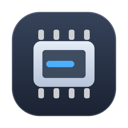
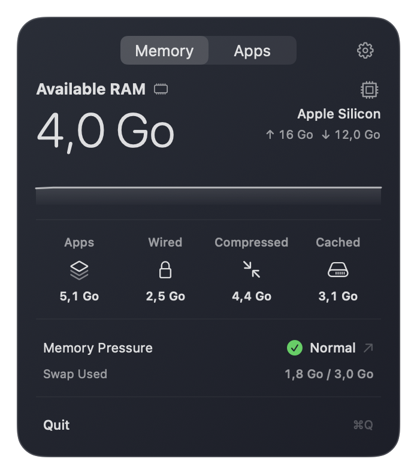
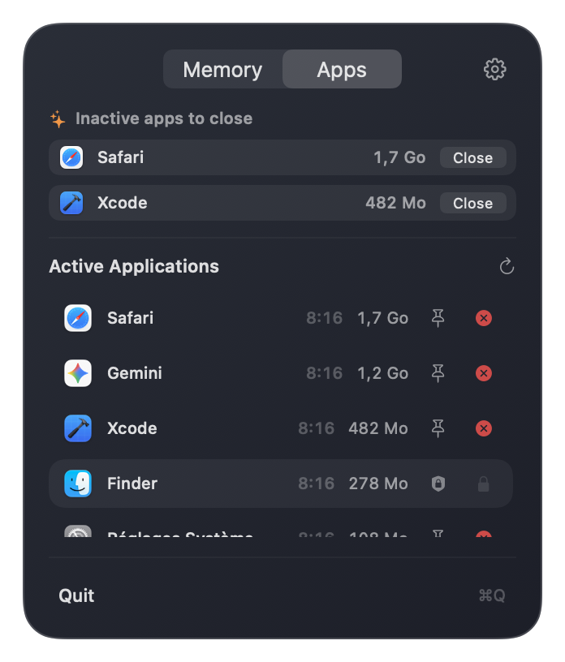
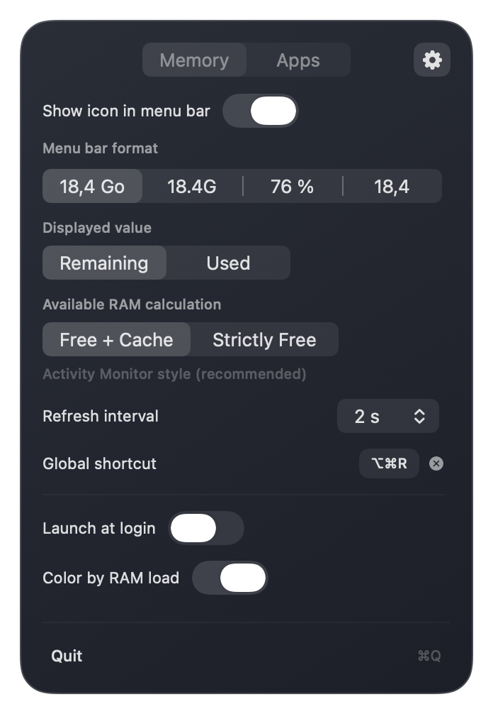

<div align="center">

#  RamBar

Real-time macOS menu bar RAM monitor for Apple Silicon: <br/> Liquid Glass design, true per-app memory footprint, and smart Auto-Close.

**Version 1.0** · Built with [SwiftUI](https://developer.apple.com/xcode/swiftui/) · Swift 6 · macOS 26+ (Apple Silicon)

[](https://github.com/fabburst/RamBar/releases/latest)
[](#installation)
[](#development)
[](#development)

**[Download RamBar.zip](https://github.com/fabburst/RamBar/releases/latest/download/RamBar.zip)** · **[Télécharger RamBar.zip](https://github.com/fabburst/RamBar/releases/latest/download/RamBar.zip)**

**[English](#english)** · **[Français](#français)**

**[Features](#features)** · **[Installation](#installation)** · **[Settings & Auto-Close](#settings--auto-close)** · **[Project Structure](#project-structure)** · **[Development](#development)**

<br/>

<table>
<tr>
<td align="center"><br/><sub><b>Memory / Mémoire</b></sub></td>
<td align="center"><br/><sub><b>Apps</b></sub></td>
<td align="center"><br/><sub><b>Settings / Réglages</b></sub></td>
</tr>
</table>

</div>

---

## English

### Overview

RamBar is a lightweight, native macOS menu bar utility written in **Swift 6** and **SwiftUI** exclusively for recent **Apple Silicon** Macs (`macOS 26+`), with no legacy compatibility overhead.

It displays available or used memory directly in your menu bar using native Liquid Glass styling, groups child/helper/WebKit processes so you see the **real memory freed** when closing an app, and optionally closes idle heavy apps when RAM gets tight.

**What makes RamBar stand out:**

- **True per-app memory footprint.** Uses `proc_pid_rusage` (`ri_phys_footprint`), `pbi_ppid`, `proc_pidpath`, and macOS responsibility APIs so browsers and Electron apps include all their tabs and helper processes (just like Activity Monitor).
- **Flexible menu bar display.** Choose between `18,4 Go`, `18.4G`, `18,4`, or a custom **Chipset %** icon (*Outline* or *Filled*), with or without icon, showing remaining or used RAM.
- **Custom dynamic colors.** Set two custom percentage thresholds and pick any color via the native macOS color wheel with live preview directly in the menu bar.
- **Smart Auto-Close & pinning.** Pin apps to protect them permanently (Finder is always protected), get idle-app suggestions, or enable automatic closing with Do Not Disturb rules and one-click relaunch history.

### Installation

Download **[RamBar.zip](https://github.com/fabburst/RamBar/releases/latest/download/RamBar.zip)** from the [latest release](https://github.com/fabburst/RamBar/releases/latest), unzip it, and move `RamBar.app` to `/Applications` (Apple Silicon, macOS 26+).

Or build from source and install into `/Applications`:

```sh
git clone https://github.com/fabburst/RamBar.git
cd RamBar
./build-app.sh
cp -R RamBar.app /Applications/RamBar.app
open /Applications/RamBar.app
```

To sign with your Apple Developer certificate:

```sh
SIGN_IDENTITY="Developer ID Application: Your Name (TEAMID)" ./build-app.sh
```

> RamBar is **not notarized by Apple** (no paid developer account), so after a download macOS Gatekeeper may refuse to open it with a plain double-click.
> - **Right-click (or Control-click) the app → Open → Open**, or *System Settings → Privacy & Security → Open Anyway*. Only once.
> - Or use **[Sentinel](https://github.com/alienator88/Sentinel)** (free, open source): drag `RamBar.app` onto it to remove the quarantine (`brew install alienator88/homebrew-cask/sentinel-app`).

### Features

| Feature | Status |
|---|---|
| Menu bar formats: `18,4 Go`, `18.4G`, `18,4`, Chipset `%` (*Outline* / *Filled*) | ✅ |
| Toggleable menu bar icon & Remaining / Used metric switch | ✅ |
| Calculation mode: *Free + Cache* (Activity Monitor style) or *Strictly Free* | ✅ |
| Liquid Glass popover with live 30-sample sparkline, Swap usage & Memory Pressure | ✅ |
| True per-app footprint (includes WebKit tabs, Helpers, child processes) | ✅ |
| App pinning ("never close") + permanent Finder protection + last-used time | ✅ |
| Customizable 2-level threshold colors via native macOS `NSColorPanel` + live preview | ✅ |
| Smart Auto-Close (RAM %, idle time, app categories) + Do Not Disturb (fullscreen, calls, battery) | ✅ |
| Auto-Close history with one-click Relaunch & macOS notifications | ✅ |
| Customizable global shortcut (`⌥⌘R` by default), Launch at Login, EN / FR localization | ✅ |

### Settings & Auto-Close

- **Launch at Login**: native `SMAppService.mainApp` integration.
- **Global Shortcut**: record any key combination in **Settings** to refresh and toggle the popover from anywhere.
- **Refresh Interval**: `1 s`, `2 s`, `5 s`, or `10 s`.
- **Auto-Close Conditions**: triggers only when **all** conditions match (RAM used > X %, app idle for X min, app belongs to selected categories, not pinned, not active, and not paused by Do Not Disturb).

### Project Structure

| Path | Role |
|---|---|
| `Sources/RamBar/RamBarApp.swift` | SwiftUI `MenuBarExtra` entry point, menu bar label & hotkey wiring |
| `Sources/RamBarCore/MemoryMonitor.swift` | `host_statistics64`, `vm.swapusage`, process-tree footprint & Auto-Close engine |
| `Sources/RamBarCore/SettingsStore.swift` | `@Observable` `UserDefaults` persistence & `SMAppService` launch at login |
| `Sources/RamBarCore/MemoryPopoverView.swift` | Liquid Glass popover UI (*Memory*, *Apps*, *Settings*) |
| `Sources/RamBarCore/ChipsetPercentImage.swift` | Custom Retina chipset icon (*Outline* & *Filled*) with carved percentage |
| `Sources/RamBarCore/GlobalHotKeyManager.swift` | Carbon `RegisterEventHotKey` global shortcut manager |
| `Sources/RamBarCore/NotificationManager.swift` | `UNUserNotificationCenter` alerts for Auto-Close & Critical pressure |
| `Sources/RamBarCore/ColorPanelCoordinator.swift` | Native `NSColorPanel` color wheel bridge with live menu bar preview |
| `Sources/RamBarCore/Resources/` | `AppIcon.icns` & `en.lproj` / `fr.lproj` `Localizable.strings` |
| `Tests/RamBarTests/` | Swift Testing unit test suite |
| `build-app.sh` | Release build, `.app` bundling, icon/resources packaging & codesigning |

### Development

Requirements: macOS 26+, Xcode 26+ (Swift 6.2) on Apple Silicon.

```sh
swift test --disable-sandbox     # Run unit tests
./build-app.sh                   # Build release RamBar.app
open Package.swift               # Open in Xcode to archive or sign with your team
```

---

## Français

### Vue d'ensemble

RamBar est une application native macOS légère en **Swift 6** et **SwiftUI**, conçue exclusivement pour les Mac **Apple Silicon** récents (`macOS 26+`), sans compatibilité avec les anciens Mac.

Elle affiche la RAM disponible ou occupée directement dans la barre de menus avec le style Liquid Glass natif, regroupe les sous-processus et onglets WebKit pour afficher le **gain réel** à la fermeture d'une app, et peut fermer automatiquement les apps inactives gourmandes lorsque la mémoire se remplit.

**Ce qui distingue RamBar :**

- **Empreinte mémoire réelle par application.** Combine `proc_pid_rusage` (`ri_phys_footprint`), l'arbre `pbi_ppid`, `proc_pidpath` et l'API de responsabilité macOS pour inclure tous les onglets Safari/Chrome, Helpers Electron et processus enfants.
- **Affichage barre de menus flexible.** Choisissez entre `18,4 Go`, `18.4G`, `18,4` ou une icône **Chipset %** (*Contour* ou *Plein*), avec ou sans icône, en valeur *Restante* ou *Occupée*.
- **Couleurs et seuils personnalisables.** Réglez 2 seuils (%) et choisissez n'importe quelle couleur via la roue native macOS avec prévisualisation en direct sur la barre de menus.
- **Auto-Close intelligent et épinglage.** Épinglez les apps à ne jamais toucher (le Finder est toujours protégé), recevez des suggestions d'apps inactives ou activez la fermeture automatique avec mode *Ne pas déranger* et historique avec bouton *Relancer*.

### Installation

Téléchargez **[RamBar.zip](https://github.com/fabburst/RamBar/releases/latest/download/RamBar.zip)** depuis la [dernière release](https://github.com/fabburst/RamBar/releases/latest), décompressez-le et déplacez `RamBar.app` dans `/Applications` (Apple Silicon, macOS 26+).

Ou compilez depuis les sources et installez dans `/Applications` :

```sh
git clone https://github.com/fabburst/RamBar.git
cd RamBar
./build-app.sh
cp -R RamBar.app /Applications/RamBar.app
open /Applications/RamBar.app
```

Pour signer avec votre certificat Apple Developer :

```sh
SIGN_IDENTITY="Developer ID Application: Votre Nom (TEAMID)" ./build-app.sh
```

> RamBar n'est **pas notarisée par Apple** (pas de compte développeur payant) : après téléchargement, Gatekeeper peut refuser de l'ouvrir d'un simple double-clic.
> - **Clic droit (ou Contrôle-clic) sur l'app → Ouvrir → Ouvrir**, ou *Réglages Système → Confidentialité et sécurité → Ouvrir quand même* (une seule fois).
> - Ou utilisez **[Sentinel](https://github.com/alienator88/Sentinel)** (gratuit, open source) : glissez `RamBar.app` dessus pour retirer la quarantaine (`brew install alienator88/homebrew-cask/sentinel-app`).

### Fonctionnalités

| Fonction | État |
|---|---|
| Formats barre de menus : `18,4 Go`, `18.4G`, `18,4`, icône Chipset `%` (*Contour* / *Plein*) | ✅ |
| Icône activable/désactivable & bascule Restante / Occupée | ✅ |
| Calcul : *Libre + Cache* (façon Moniteur d'activité) ou *Strictement libre* | ✅ |
| Popover Liquid Glass avec sparkline (30 relevés), Swap utilisé et Pression mémoire | ✅ |
| Empreinte réelle par app (onglets WebKit, Helpers, sous-processus inclus) | ✅ |
| Épinglage (« ne jamais toucher »), protection permanente du Finder & heure de dernière utilisation | ✅ |
| Couleurs de seuils libres via la roue macOS (`NSColorPanel`) + aperçu en direct | ✅ |
| Auto-Close (seuil RAM %, inactivité, catégories) + Ne pas déranger (plein écran, appels, batterie) | ✅ |
| Journal des fermetures Auto-Close avec bouton Relancer & notifications macOS | ✅ |
| Raccourci clavier global personnalisable (`⌥⌘R` par défaut), Lancer au démarrage, FR / EN | ✅ |

### Réglages et Auto-Close

- **Lancer au démarrage** : intégration native `SMAppService.mainApp`.
- **Raccourci global** : enregistrez la combinaison de touches de votre choix dans **Réglages** pour rafraîchir et ouvrir/fermer le popover depuis n'importe où.
- **Rafraîchissement** : `1 s`, `2 s`, `5 s` ou `10 s`.
- **Conditions Auto-Close** : agit uniquement si **toutes** les conditions sont réunies (RAM utilisée > X %, app inactive depuis X min, catégorie autorisée, app non épinglée, non active au premier plan, et hors pause *Ne pas déranger*).

### Organisation du projet

| Chemin | Rôle |
|---|---|
| `Sources/RamBar/RamBarApp.swift` | Point d'entrée SwiftUI `MenuBarExtra`, barre de menus et raccourci global |
| `Sources/RamBarCore/MemoryMonitor.swift` | `host_statistics64`, `vm.swapusage`, calcul par groupe de processus et moteur Auto-Close |
| `Sources/RamBarCore/SettingsStore.swift` | Persistance `UserDefaults` (`@Observable`) et `SMAppService` |
| `Sources/RamBarCore/MemoryPopoverView.swift` | Interface Liquid Glass (*Mémoire*, *Apps*, *Réglages*) |
| `Sources/RamBarCore/ChipsetPercentImage.swift` | Icône chipset Retina (*Contour* et *Plein*) avec pourcentage intégré |
| `Sources/RamBarCore/GlobalHotKeyManager.swift` | Gestionnaire de raccourci clavier global (`RegisterEventHotKey`) |
| `Sources/RamBarCore/NotificationManager.swift` | Notifications `UNUserNotificationCenter` (Auto-Close & pression critique) |
| `Sources/RamBarCore/ColorPanelCoordinator.swift` | Pont vers la roue des couleurs native `NSColorPanel` |
| `Sources/RamBarCore/Resources/` | `AppIcon.icns` et traductions `fr.lproj` / `en.lproj` |
| `Tests/RamBarTests/` | Suite de tests unitaires Swift Testing |
| `build-app.sh` | Compilation `release`, assemblage `.app`, icône/ressources et signature |

### Développement

Prérequis : macOS 26+, Xcode 26+ (Swift 6.2) sur Apple Silicon.

```sh
swift test --disable-sandbox     # Lancer les tests unitaires
./build-app.sh                   # Générer RamBar.app en release
open Package.swift               # Ouvrir dans Xcode pour archiver ou signer
```
